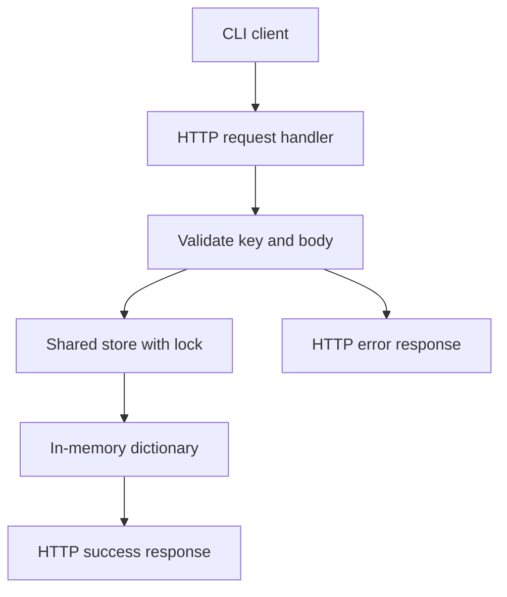

# Distributed Key-Value Store — WDP Final Project

**TL;DR:** I chose **Project 2: Redis-Like Key-Value Server**. I am building a Python HTTP service that stores text by key, then extending it with automatic routing across multiple nodes and replication for node failures.

**Stage:** C-tier

## What I am building

A key identifies a value, such as `name` → `ada`. A command-line client sends PUT, GET, and DELETE requests to my Python server. The server owns an in-memory dictionary and returns meaningful HTTP status codes.

The project grows in three cumulative stages:

| Tier | Development goal |
| --- | --- |
| C | One correct, thread-safe HTTP storage node and a CLI client. |
| B | Three nodes, automatic consistent-hash routing, and controlled migration when a fourth joins. |
| A | Two copies per key, replica reads during primary failure, and documented failure behavior. |

## C tier — one reliable storage node

The first goal is a small server I can run, test, and explain before adding distributed behavior.

The CLI sends requests over HTTP. The handler validates them and calls the storage class. Request threads share the same dictionary, so storage operations use a lock.



### Files I need to write

| File | Work |
| --- | --- |
| `store.py` | Implement locked `put`, `get`, and `delete` operations. |
| `handler.py` | Parse requests, validate input, and translate results into HTTP responses. |
| `server.py` | Read `--port`, create the shared store, and start a threaded server. |
| `client.py` | Implement direct-node HTTP calls and CLI commands. |
| `tests/test_api.py` | Check the required status codes and input errors. |
| `tests/race_test.py` | Send at least 20 simultaneous writes and verify stored values. |

### Required HTTP behavior

| Request | Result |
| --- | --- |
| PUT a new key | 201 |
| PUT an existing key | 200 |
| GET an existing / absent key | 200 / 404 |
| DELETE an existing / absent key | 204 / 404 |
| Unsupported HTTP method | 405 |
| Missing key or PUT body | 400 |

I plan to store UTF-8 strings and reject empty PUT bodies. Data disappears when the server stops. Optional JSON response wrappers must preserve the stored string value and be explained in the API contract.

### Work checklist

- [ ] Implement the locked dictionary.
- [ ] Implement and validate the HTTP operations.
- [ ] Return 405 for unsupported methods, including methods without a handler.
- [ ] Start the server using a command-line port.
- [ ] Add CLI put/get/delete commands with finite request timeouts.
- [ ] Test distinct-key concurrency and read every value back.
- [ ] Test concurrent writes to one new key: exactly one creation response, then replacements.
- [ ] Verify startup and client commands from a clean environment.

### Planned commands

These are the interface I intend to implement; they do not run from this documentation package. On Windows I will use `py`; on Linux/macOS, replace it with `python3`.

```shell
py server.py --port 7101
```

In another terminal:

```shell
py client.py --node 127.0.0.1:7101 put name ada
py client.py --node 127.0.0.1:7101 get name
py client.py --node 127.0.0.1:7101 delete name
py -m unittest discover -s tests -p "test_*.py"
py -m tests.race_test
```

The intended test layout includes `tests/__init__.py`. Tests will start and stop their own nodes on available ports rather than rely on leftover server state.

---

## B tier — coming soon

I will add a stable hashing ring and a configuration file describing three storage nodes. The client will automatically select the correct node. A migration script will show old and new owners and copy only affected keys when a fourth node joins. I will document the hashing algorithm in a one-page explanation.

---

## A tier — coming soon

I will store each key on its primary and the next distinct node clockwise. The client will attempt writes to both, fall back to a replica when the primary is unavailable, and use timeouts. A failure demo and a 1–2-page analysis will explain partial writes, stale nodes, and losing both copies.